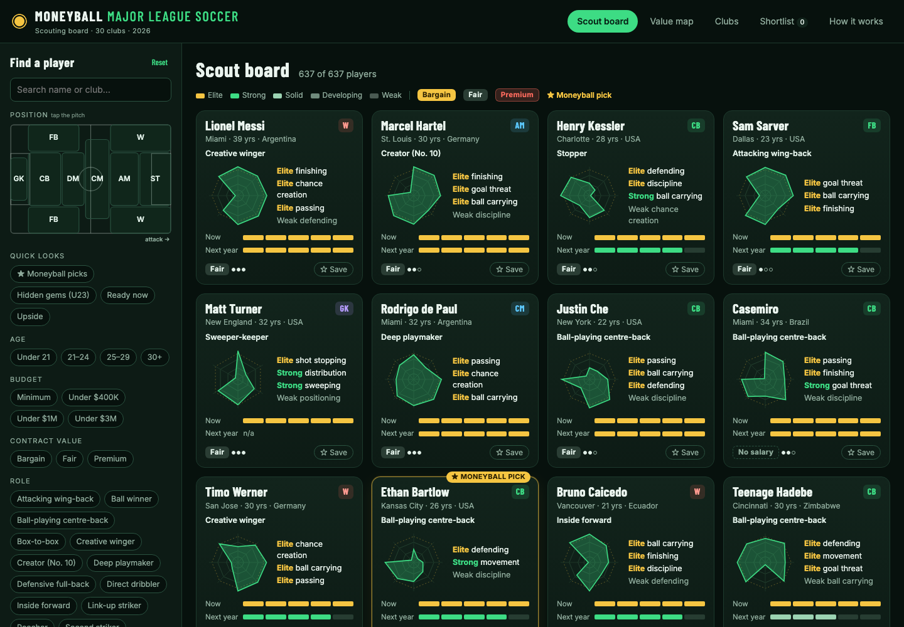
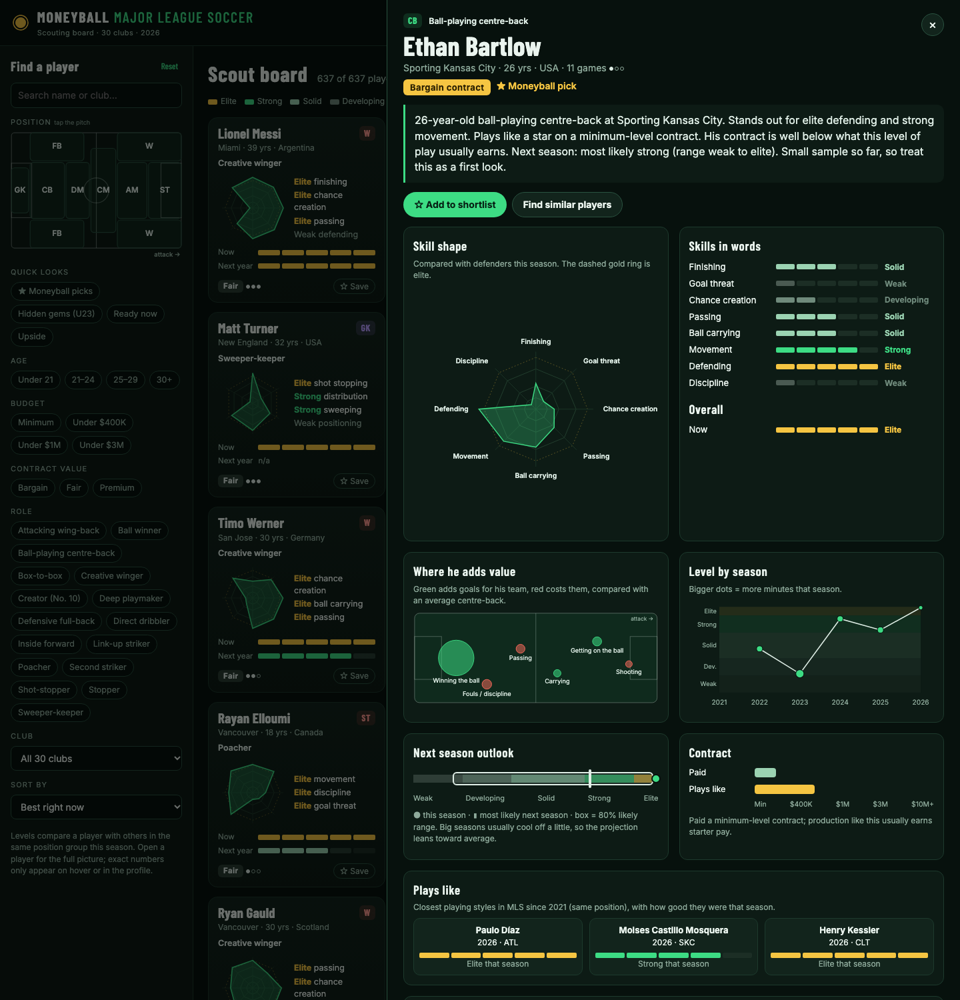

# Moneyball MLS

**A machine-learning scouting board for all 30 Major League Soccer clubs.** It shows each player's role, skill shape, comparable players, next-season outlook and contract value as pictures and plain words instead of spreadsheets.

**Live app:** https://moneyball-mls.web.app



## What a scout sees

| View | What it answers |
|---|---|
| **Scout board** | Player cards: role, a skill-shape radar, top strengths in words, level now and next season as 5-step meters, contract tag (Bargain / Fair / Premium) and sample-size dots. Filter by tapping positions on a pitch, age, budget, role, club or "quick looks" (Moneyball picks, hidden gems U23, ready now, upside). |
| **Player profile** | A one-paragraph scouting summary; skill shape and skills in words; *where he adds value* on a pitch (bubbles for winning the ball, passing, carrying, getting on the ball, shooting); level by season; next-season outlook with an 80% range; paid vs "plays like" contract bars; three players with the closest style since 2021. |
| **Value map** | Level vs pay for every player. The gold corner is where bargains live. |
| **Clubs** | Each club's most-used XI on a pitch (ring = level, fill = contract value) plus its bargains and full squad. |
| **Shortlist** | Saved players, with up to three skill shapes overlaid for comparison. |

Levels (Elite, Strong, Solid, Developing, Weak) are percentiles within the player's position group this season. Exact numbers appear only on hover or in the profile's "for the numbers people" section.



## Machine learning

| Model | Method | Validation |
|---|---|---|
| **Playing roles** | k-means within each position (CB, FB, DM/CM, AM, W, ST, GK) on a 13-feature style profile, 900+ minute seasons 2021–2026. Clusters are named by rules on their centroids, for example ball-playing centre-back vs stopper. | Centroids inspected; 16 roles |
| **Plays like** | Cosine similarity on the same standardized style profile, searching every MLS season since 2021 | – |
| **Next-season outlook** | Ridge regression on minutes-weighted, multi-season goals added (shrunk toward the position average), style and age. LightGBM quantile models and simple shrinkage were tested and did worse. The 80% range comes from held-out residuals by minutes band. | Rolling seasons (see below); the 80% range contained 79.8% of real outcomes |
| **Contract value** | LightGBM on production, age and position predicting log guaranteed pay (what MLS usually pays for that production); out-of-fold predictions grouped by player, floored at the league minimum | R² 0.52 on log pay (5-fold, 3,783 player-seasons); typical miss ×1.6 |

Next-season error (minutes-weighted MAE, goals added per 96 minutes; lower is better):

| Test seasons | Ridge model | Same as last season | Shrink to average |
|---|---|---|---|
| 2022 → 2023 | **0.0419** | 0.0484 | 0.0424 |
| 2023 → 2024 | **0.0424** | 0.0523 | 0.0441 |
| 2024 → 2025 | **0.0445** | 0.0535 | 0.0456 |

Tags: **Bargain** means paid less than half of the model's fair pay while performing at least at Solid level. **Premium** means paid more than twice the fair pay and not Elite. **★ Moneyball pick** means a Bargain expected to stay at least Solid next season. With the April 2026 MLSPA release, that gives 42 bargains among 637 players.

## Data

* [American Soccer Analysis](https://www.americansocceranalysis.com/) public API: xGoals, xPass and goals added (g+) for players and goalkeepers, MLS 2021–2026 (2026 season to date, fetched 10 Oct 2026).
* Guaranteed compensation from MLS Players Association salary releases, as provided by ASA (latest: 16 Apr 2026).
* 30 clubs in 2026, including San Diego FC; 637 players with 300+ minutes are shown.

Raw API responses are cached in `data/raw/` and are not committed. Run the pipeline to rebuild everything.

## Rebuild

```bash
pip install pandas numpy scikit-learn lightgbm scipy
python3 pipeline/fetch_asa.py        # ASA API -> data/raw/ (cached)
python3 pipeline/build_dataset.py    # -> data/player_seasons.csv (one row per player-season)
python3 pipeline/train_models.py     # roles, comps, projection, fair salary -> data/model_outputs.json, data/model_report.json
python3 pipeline/export_web.py       # -> website/data/*.json
python3 -m http.server 8000 --directory website
```

Deploy: `firebase deploy --only hosting:moneyball-mls --project moneyball-3-1`.

## Limits

* Event data does not see off-ball work, pressing, character, injuries or tactical fit. Use it to decide whom to watch, not whom to sign.
* Small samples (one filled dot = under 900 minutes) swing a lot. Goalkeepers have levels and roles but no next-season projection yet.
* Contract tags ignore transfer fees, allocation money, roster designations and how a player was acquired.
* Goals added is ASA's model; its values are above average for the player's position.

## Project history

This repository started as *Moneyball 3.1* (undervalued MLB hitters, Oct 2026) and was reworked into an MLS machine-learning project.

Built by Hendro Setyawan. Not affiliated with Major League Soccer, the MLSPA or American Soccer Analysis.
